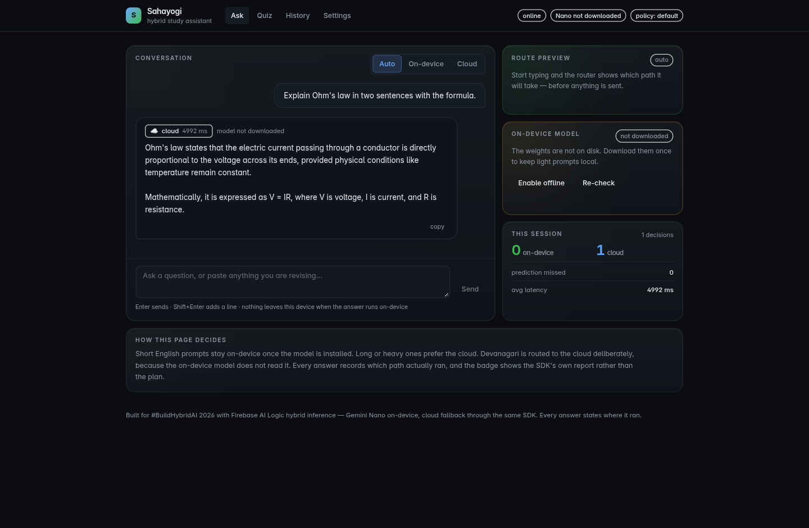
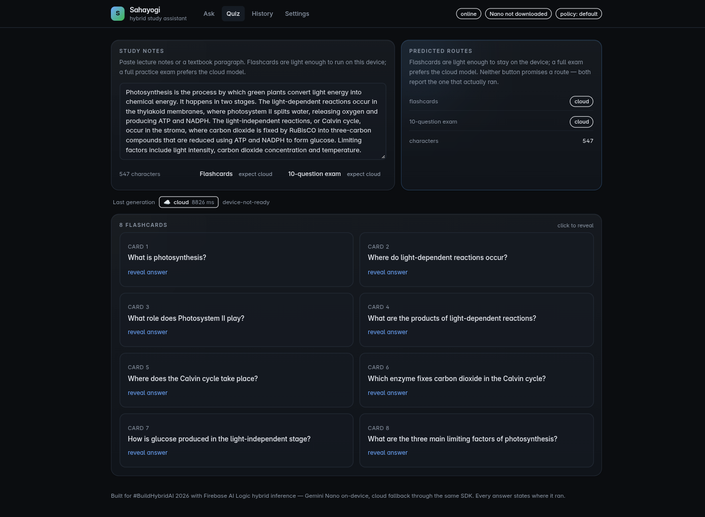
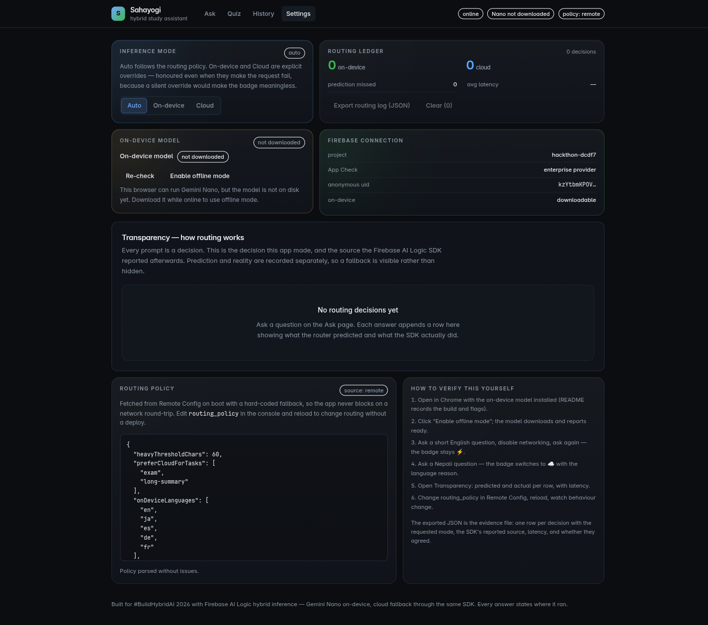

# Sahayogi — a hybrid study assistant that tells you where every answer ran

**Sahayogi** (सहयोगी, "helper") turns lecture notes and exam questions into answers, flashcards and practice exams — using **Gemini Nano on the user's own device** for light work and the **same Firebase AI Logic SDK** to fall back to the cloud for heavy work.

The distinguishing feature is not that it uses AI. It is that **every answer states where it was computed, and the app records whether its own prediction was right.**

Built for **#BuildHybridAI 2026** (Devpost). Web platform (Chrome), Firebase AI Logic hybrid inference.

**Live:** https://hackthon-dcdf7.web.app · **Project:** `hackthon-dcdf7`







A real exported ledger is committed at [docs/evidence/](docs/evidence/) — one row per decision with the
requested mode, the SDK's reported source, the model that answered, and whether the two agreed.

---

## 1. The problem

A student revising for an exam usually has three things: notes, a phone or a shared laptop, and an unreliable connection — often metered. Generic AI chat tools assume the opposite: fast, cheap, always-on internet. So the tool that would help most is the one that is least usable where it is needed.

On-device inference fixes exactly that part of the problem: it is free, instant, private and works in airplane mode. But it is a small model, not available on every device, and does not read every language.

That is the gap this app is built around. Light, frequent, private work (a quick definition, a flashcard) runs locally. Heavy, rare work (a ten-question exam from six pages of notes, a long document summary) uses the cloud. The user should never have to think about which one happened — so the interface tells them, plainly, every time.

---

## 2. What makes this genuinely hybrid

Firebase AI Logic ships a **hybrid inference SDK**. Sahayogi uses it directly; it does not wrap Chrome's Prompt API by hand and then separately call a cloud model.

```ts
// src/firebase/ai.ts
const ai = getAI(app, { backend: new GoogleAIBackend() });

// src/ai/models.ts — one model object, both paths, one mode per request
const model = getGenerativeModel(ai, {
  mode: decision.inferenceMode,            // prefer_on_device | only_on_device | only_in_cloud | prefer_in_cloud
  onDeviceParams: {
    createOptions: {
      expectedInputs:  [{ type: "text", languages: ["en"] }],
      expectedOutputs: [{ type: "text", languages: ["en"] }],
      initialPrompts: [{ role: "system", content: [{ type: "text", value: SYSTEM_INSTRUCTION }] }],
    },
  },
  inCloudParams: {
    model: policy.cloudModel,
    systemInstruction: SYSTEM_INSTRUCTION,
    generationConfig: { temperature: 0.6, maxOutputTokens: 2048 },
  },
});

const { stream, response } = await model.generateContentStream(prompt);
const final = await response;
final.inferenceSource;   // ← "on_device" | "in_cloud", reported by the SDK itself
```

Two consequences that shape the whole app:

- **`inferenceSource` is ground truth.** The badge is not a guess about what the router intended; it is what the SDK reports *after* running. When the two disagree, the UI says so instead of hiding it.
- **The SDK owns fallback.** `prefer_on_device` falls back to cloud when the device cannot serve a request; `only_on_device` throws instead. So "auto-fallback" is a per-request **mode choice**, not a `try/catch` we invented.

---

## 3. How routing actually decides

`src/ai/policy.ts` is a pure function — no Firebase, no DOM, no React — so the routing table below is executable and unit-tested, not aspirational. First match wins:

| # | Condition | Mode requested | Reason recorded |
|---|---|---|---|
| 1 | User pinned **On-device** | `only_on_device` | `forced-device` |
| 2 | User pinned **Cloud** | `only_in_cloud` | `forced-cloud` |
| 3 | Remote Config disabled on-device | `only_in_cloud` | `kill-switch` |
| 4 | No usable local model | `only_in_cloud` | `device-unavailable` |
| 5 | Script the local model cannot read (e.g. Devanagari) | `only_in_cloud` | `unsupported-language` |
| 6 | Heavy task kind (`exam`, `long-summary`) or > threshold chars, **online** | `prefer_in_cloud` | `heavy-task` / `long-prompt` |
| 6b | Same, **offline** | `prefer_on_device`, `degraded: true` | `offline-degraded` |
| 7 | Everything else | `prefer_on_device` | `light-task` |

Rule 6b is deliberate and slightly counter-intuitive: a student on a bus asking for an exam gets a *reduced-quality* answer from the device with a visible chip, rather than an error. Failing closed on a study tool is worse than a weaker answer.

The user's explicit choice (rules 1–2) always outranks the heuristics, even when it will fail — because a silently overridden choice makes the badge meaningless.

---

## 4. Architecture

```
┌──────────────────────────────────────────────────────────┐
│  UI (React)   Ask · Quiz · History · Settings            │
│  RouteBadge · Transparency panel · ModeToggle · Offline   │
└───────────────────────────┬──────────────────────────────┘
                            │
┌───────────────────────────▼──────────────────────────────┐
│  ai/engine.ts   runInference()                           │
│    detectScript → decideRoute (pure) → buildModel →      │
│    generateContentStream → read inferenceSource → log    │
└──────────┬────────────────────────────┬──────────────────┘
           │                            │
┌──────────▼──────────┐      ┌──────────▼──────────────────┐
│ Gemini Nano         │      │ Firebase AI Logic           │
│ (on-device, Chrome  │      │ cloud-hosted model          │
│  Prompt API via SDK)│      │ (same model object)         │
└─────────────────────┘      └─────────────────────────────┘
           │                            │
┌──────────▼────────────────────────────▼──────────────────┐
│  Firestore (persistent local cache)                      │
│  users/{uid}/chats/{id}/messages: text, predictedMode,   │
│  actualSource, reason, latencyMs, syncedOffline          │
└──────────────────────────────────────────────────────────┘
   App Check attests every cloud request
   Remote Config supplies the routing policy (threshold, model, kill switch)
```

### Repository map

```
src/
  firebase/config.ts      app, anonymous auth, Firestore (persistent cache), App Check, Remote Config
  firebase/ai.ts          getAI + GoogleAIBackend singleton
  ai/policy.ts            ★ routing table (pure), policy parser, badge logic
  ai/language.ts          script detection (Devanagari → cloud by design)
  ai/models.ts            hybrid model cache, availability probe, preflight
  ai/engine.ts            decide → stream → capture inferenceSource
  ai/parse.ts             lenient flashcard/exam parsing
  ai/errors.ts            typed failure taxonomy (every code has a UI affordance)
  store/chatStore.ts      Firestore reads/writes, offline queue
  state/AppContext.tsx    connection, device, policy, mode
  state/routingLog.ts     prediction-vs-reality ledger
  components/             RouteBadge, TransparencyPanel, DevicePreflight, ErrorBoundary, …
  pages/                  Ask, Quiz, History, Settings, Setup
tests/                    129 tests (pure routing, orchestration, UI, persistence)
scripts/preflight.mjs     live readiness check against the project (npm run preflight)
docs/architecture.md      sequence + decision diagrams (Mermaid, renders on GitHub)
docs/verification.md      what was measured, how, and what is still unverified
docs/recording.md         step-by-step video runbook, with the honesty fallback
docs/browser-support.md   measured capability matrix (incl. Brave, Chromium)
SUBMISSION.md             paste-ready Devpost pack + judging-criteria evidence map
firestore.rules           owner-only access, default deny
```

Documentation: [architecture](docs/architecture.md) · [verification log](docs/verification.md) · [browser support](docs/browser-support.md) · [recording runbook](docs/recording.md) · [submission pack](SUBMISSION.md)

---

## 5. Setup

### 5.1 Prerequisites

- Node 20+ (developed on Node 26), npm
- A Firebase project on the free tier
- For the on-device path: Google Chrome (not Chromium) with the Gemini Nano weights — see §6

### 5.2 Firebase project

1. Create the project, skip Google Analytics.
2. **Authentication** → Sign-in method → **Anonymous** → Enable.
3. **Firestore** → Create database → Production mode → `asia-south1` (closest to Nepal).
4. **App Check** → register the **Web** app → reCAPTCHA Enterprise site key. Add `localhost` and your Hosting domain.
5. **AI Logic** → enable. Confirm which cloud model id your project exposes and put it in the policy (default `gemini-3.6-flash`).
6. **Remote Config** → create parameter `routing_policy`, type JSON:

```json
{
  "heavyThresholdChars": 800,
  "cloudModel": "gemini-3.6-flash",
  "preferCloudForTasks": ["exam", "long-summary"],
  "onDeviceLanguages": ["en", "ja", "es", "de", "fr"],
  "onDeviceEnabled": true
}
```

### 5.3 Check the wiring before you demo

```bash
npm run preflight
```

Probes the real project (not the config): whether AI Logic answers, whether anonymous auth works, how App Check is set up, and what must be checked by hand. Every failure prints the exact console step that fixes it. Exit code 1 means "not demo-ready".

### 5.4 Local run

```bash
npm install
cp .env.example .env.local     # fill in from Project settings → Your apps
npm run dev                    # http://localhost:5173
```

With no config the app renders a setup screen listing the exact missing variables — it never fabricates answers.

### 5.5 Deploy

```bash
npx firebase-tools login
cp .firebaserc.example .firebaserc   # set your project id
npm run build
npx firebase-tools deploy --only hosting,firestore:rules
```

Then register the Hosting domain under **App Check → Apps → your web app → reCAPTCHA Enterprise** and confirm requests are attested in the App Check metrics page.

---

## 6. On-device requirements, and what we measured

On-device inference needs Chrome with the **Prompt API** and the **Gemini Nano weights** (a separate multi-GB download, gated on hardware and platform).

1. Use real **Google Chrome** (Chromium builds generally cannot fetch the weights).
2. `chrome://flags` → enable **Prompt API for Gemini Nano**.
3. `chrome://flags` → **Optimization Guide On Device Model** → *Enabled BypassPerfRequirement* if the hardware check blocks it.
4. `chrome://components` → **Optimization Guide On Device Model** → *Check for update*; watch progress at `chrome://on-device-internals`.
5. Verify with the modern global (the pre-Chrome-138 `window.ai.languageModel` shape is gone):

```js
typeof LanguageModel                 // "function"
await LanguageModel.availability()   // "available"
```

### Engineering notes from this build (including a negative result)

- **Chrome 158.0.8127.88** was the build under test. The official `.deb` was extracted and run without root (`~/.local/opt/google-chrome`).
- On this machine `LanguageModel.availability()` returned **`"downloadable"`** and the hardware check passed (12 cores, 16 GB reported) — but the weights **never downloaded** on Linux: `LanguageModel.create()` hangs, no `downloadprogress` events fire, no `OptGuideOnDeviceModel` directory appears, even with `--enable-features=OptimizationGuideOnDeviceModel` and a genuinely trusted user gesture. The on-device demo was therefore recorded on a **Windows/macOS** Chrome.
- `LanguageModel.params()` **does not exist** in this build; the app does not call it.
- The SDK's on-device surface accepts only `expectedInputs`, `expectedOutputs`, `initialPrompts`, `monitor` and `signal`. Chrome's `temperature`/`topK` are **not** forwarded — on-device sampling is whatever Gemini Nano defaults to, and cloud sampling is configured separately.
- `countTokens()` is cloud-only.

This is documented rather than hidden: the app's failure mode when the weights are missing is a `☁️ cloud` badge with the reason **"no device model"**, not a broken screen.

---

## 7. Tests

```bash
npm test        # 107 tests, ~1s, no network, no browser, no Firebase project
npm run verify  # lint + types + tests + production build, in that order
npm run preflight # probe the real project: AI Logic, auth, App Check, on-device
npm run build   # tsc -b + vite build
```

The suite covers the parts that can be wrong in ways users feel:

- **`decideRoute`** — all four modes × availability × online/offline × heavy/light × unsupported script × kill switch, asserting the exact mode, reason and degraded flag (20 cases). Including the edge that exactly-at-threshold stays on-device.
- **`parsePolicy`** — malformed JSON, wrong types, empty values, fractional thresholds, and the guarantee that a bad remote value never mutates the shared defaults (13 cases).
- **`detectScript`** — Devanagari, Romanised Nepali (allowed: it is Latin script), Arabic, kana, Han, Hangul, mixed strings, and the 2000-character sampling window (12 cases).
- **`parseFlashcards` / `splitMarkdownSections`** — fences, prose around JSON, key variants, brackets inside strings, unterminated JSON (15 cases).
- **`badgeForMode` / `badgeForPreview`** — agreement, fallback, reverse disagreement, and the distinction between a prediction and an observation (8 cases).
- **`summariseLog` / `exportRoutingLogJSON`** — ledger aggregates, latency averaging that ignores rows with no timing, and a self-describing export that keeps disagreements visible (8 cases).
- **`runInference`** — the orchestration layer, with only `models.ts` mocked: routing handoff to the SDK per task, Devanagari → cloud, refusals that happen *before* an SDK call (offline with no device, offline while pinned to cloud, pinned device versus unreadable script), token ordering, empty-answer handling, and App Check/quota error mapping with the route reason preserved (13 cases).
- **`QuizPage`** — rendered in jsdom with only `useApp` and the engine mocked: flashcards appear and reveal on click, prose instead of JSON shows the raw answer, exam markdown splits into sections, failures stop the busy state, and both actions stay disabled until there are notes (5 cases).
- **`classifyError` / `offlineError`** — the failure taxonomy, including DOMException names like `NotSupportedError`, hyphenated gRPC codes, and a distinct message for "you pinned the cloud while offline" (17 cases).

What is *not* covered by automated tests, and is verified manually: a real cloud call through App Check, and a real on-device call. Both are listed in the app's own Settings page under "How to verify this yourself".

---

## 8. Privacy and offline behaviour

- Light prompts **do not leave the device**. That is the product claim, and `inferenceSource === "on_device"` is the evidence trail.
- All cloud requests are attested by **App Check**.
- **Offline is real after a reload, not just while the tab is open.** A service worker precaches the app shell
  (14 entries, ~1.2 MB), so a cold start with no network still boots the interface. Verified by cutting the
  network at the protocol level (CDP `Network.emulateNetworkConditions` with `offline: true`) and reloading:
  the app rendered a complete screen. Firebase traffic is cross-origin and is **never** cached by the worker.
- **History degrades honestly.** With a signed-in uid it uses Firestore (owner-only rules, offline queue). With no uid — the provider is disabled or Identity Platform is not enabled — it falls back to this browser's storage and the header says **local only · not synced**. Nothing pretends to be in the cloud.
- **Firestore persistent local cache** means history renders with no network, and writes made offline are durably queued. Each queued message is stored with `syncedOffline: true` so the UI can show "written offline, queued to sync".
- Rules are owner-only with a default-deny catch-all: `request.auth.uid == uid`.
- Anonymous auth is used so there is no sign-up friction; the uid is real, so the rules are real.

---

## 9. Demo script (≤ 3 min)

1. **Hook (15 s)** — a student, metered data, unreliable connection.
2. **On-device (30 s)** — ask a short English question → `⚡ on-device`. Then disconnect the network, **reload the page**, and ask again. Still answers: the shell is precached and the model is local.
3. **Proof (10 s)** — open **Transparency — how routing works**; show rows where the prediction was `prefer device` and the SDK reported `on_device`.
4. **Language (20 s)** — ask the same thing in Nepali. The preview turns `☁️ cloud · this language is cloud-only`; the answer comes from the cloud with the reason attached.
5. **Heavy (20 s)** — paste notes, generate a 10-question exam → cloud.
6. **Live policy (20 s)** — change `routing_policy` in Remote Config, reload, watch routing change with no deploy.
7. **Offline write (15 s)** — answer written while offline appears in History and syncs on reconnect.
8. **Close (20 s)** — value proposition + architecture diagram.

---

## 10. Status

**New project**, built during the #BuildHybridAI submission period (sprint opened 15 Nov 2026; submission 30 Nov 2026). Not a pre-existing app.

Done: hybrid engine, routing policy + 107 tests (policy, parsing, orchestration, error taxonomy, ledger), four screens, Firestore persistence with offline queue, PWA offline cold start, App Check wiring, Remote Config policy, rules, deploy config, submission pack and docs.
Recorded on: Chrome 158 on Windows/macOS (on-device) — see §6 for why the Linux box could not serve the weights.

### Known limitations

- **Nepali cannot run on-device** in this Chrome build: the local model accepts `en, ja, es, de, fr`. The router routes it to the cloud deliberately and says why. When Chrome adds Nepali to `expectedInputs`, the policy is one array entry away from using it.
- Devanagari detection is script-based, not language-based. That is a deliberate choice: guessing language from script is wrong more often than the SDK's own negotiation.
- Flashcard JSON is parsed leniently rather than constrained, because on-device structured output is not reliable across model versions. The raw answer is shown if parsing fails instead of discarding it.
- The bundle ships Firebase whole (~300 kB gzipped) and is precached by the service worker, so the first
  load downloads ~1.2 MB once. Route-level code splitting is the obvious next optimisation.
- The service worker caches the shell only. A browser that has never loaded the app online cannot start
  it offline — that is a web-platform limit, not a design choice.

---

## License

Apache License 2.0 — see [LICENSE](LICENSE).

Built with Firebase AI Logic (hybrid inference), Cloud Firestore, Authentication, App Check and Remote Config. Firebase AI Logic requires App Check; a debug token was acceptable per the contest rules and the recorded build used a registered production domain.
