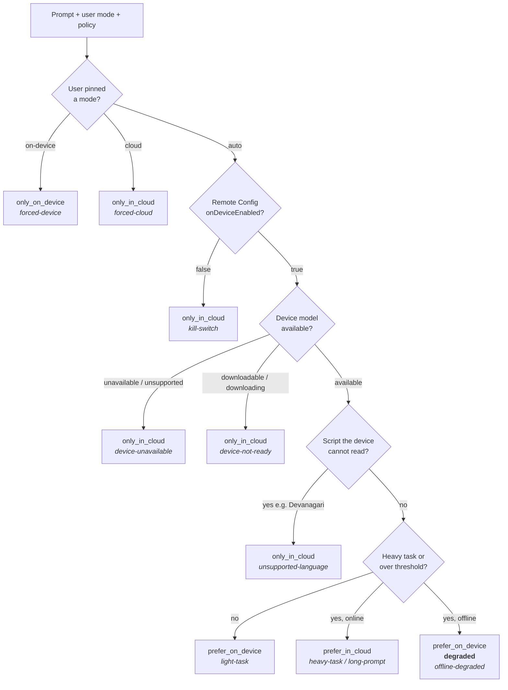

# Architecture

Two diagrams, both of which describe code that exists. The routing table is executable
(`src/ai/policy.ts`, 20 unit tests); the sequence below is the actual call path in `src/ai/engine.ts`.

## 1. One request, end to end

```mermaid
sequenceDiagram
    autonumber
    actor U as User
    participant UI as Ask page
    participant P as policy.ts (pure)
    participant E as engine.ts
    participant M as models.ts
    participant AC as App Check
    participant SDK as Firebase AI Logic SDK
    participant N as Gemini Nano (device)
    participant C as Cloud model

    U->>UI: types a question
    UI->>P: decideRoute(mode, availability, online, task, script, policy)
    P-->>UI: mode + reason  (live "route preview", dashed = prediction)

    U->>UI: Send
    UI->>E: runInference(text, taskKind, …)
    E->>P: decideRoute(...)  (same function, same inputs)
    P-->>E: prefer_on_device + "light-task"
    E->>AC: attestation token (required by AI Logic)
    AC-->>E: token, or a 401 that is classified as APP_CHECK_FAILED
    E->>M: buildModel(mode, cloudModel, systemInstruction)
    M->>SDK: getGenerativeModel({ mode, onDeviceParams, inCloudParams })
    SDK-->>M: one model object, both paths
    E->>SDK: generateContentStream(prompt)
    Note over E,SDK: device call is raced against a 12s timer;<br/>on timeout the request retries in the cloud once
    alt device can serve the request
        SDK->>N: Prompt API session
        N-->>SDK: tokens
    else device unavailable / request incompatible
        SDK->>C: cloud inference (same SDK)
        C-->>SDK: tokens
    end
    SDK-->>E: stream + response.inferenceSource
    E-->>UI: text, predicted decision, ACTUAL source, latency
    UI->>U: answer + ⚡/☁️ badge (from the SDK, not from the prediction)
    UI->>UI: append row to the ledger (predicted vs actual, agreed?)
    UI->>UI: persist message to Firestore (queued if offline)
```

The important line is `response.inferenceSource`. Nothing in this app infers the route from its own
intent; the badge and the ledger are built from what the SDK reports after the call.

## 2. The decision itself (first match wins)



Note `prefer_*` versus `only_*`: the SDK falls back to the other path on `prefer_*`, and throws on
`only_*`. That is why an explicit user choice uses `only_*` — an override that silently doesn't happen
would make the badge meaningless.

## 3. When the cloud model is the problem

The cloud path walks a chain rather than trusting one id: `routing_policy.cloudModel` first, then
`fallbackCloudModels`. A response only ends the walk if it is a real answer. `MODEL_NOT_FOUND`,
`MODEL_OVERLOADED` and `QUOTA_EXCEEDED` move on to the next id, because quota and capacity are metered
per model — a saturated primary does not mean the chain is exhausted. The badge reports the model that
answered, and the ledger records it, so a 68-second fallback walk is visible rather than mysterious.

## 4. Persistence modes

```
uid present   → Firestore  users/{uid}/chats/…   owner-only rules, offline queue
uid absent    → local      browser storage       header says "local only · not synced"
```

The facade (`src/store/persistence.ts`) is what the screens talk to, so a missing identity degrades
storage instead of breaking the app.

## 5. Data model

```
users/{uid}/chats/{chatId}
  title, createdAt, updatedAt, routeMix { onDevice, cloud }, lastReason
users/{uid}/chats/{chatId}/messages/{msgId}
  role, text,
  predictedMode   ← what the policy asked for
  actualSource    ← what the SDK reported ("on_device" | "in_cloud")
  reason, latencyMs, deviceModel, syncedOffline, createdAt
settings/{uid}
  userMode, policy, policySource, updatedAt
```

`predictedMode` and `actualSource` are stored as separate fields on purpose. Collapsing them into one
"route" field would make a fallback indistinguishable from a deliberate cloud call, and would delete the
only evidence that the router can be wrong.

## 6. Failure modes and what the user sees

| Failure | Detection | UI |
|---|---|---|
| No `LanguageModel` global | runtime probe | header chip `no Prompt API`; answers are ☁️ with `device-unavailable` |
| Weights absent | `availability()` | DevicePreflight offers the download (user gesture required) |
| Download in progress, mode pinned to device | SDK throws on `only_on_device` | `DEVICE_NOT_READY` toast with "wait or switch Mode to Auto" |
| Cloud unreachable while offline | pre-flight in `engine.ts` | `OFFLINE_NO_DEVICE`, never a spinner that never ends |
| App Check rejected | error classification | `APP_CHECK_FAILED` with the site-key/domain hint |
| Cloud model id wrong | error classification | `MODEL_NOT_FOUND` pointing at `routing_policy.cloudModel` |
| Malformed `routing_policy` | `parsePolicy` | defaults + the parse issue listed in Settings |
| Render crash | `ErrorBoundary` | actionable screen, "saved chats are still on disk" |
| Streaming aborted mid-answer | stream loop | partial text is kept, labelled, not discarded |
| Model reported `downloadable` but never arrives | 12 s race on the initial device call | one cloud retry; badge reads `cloud (fallback)` because predicted ≠ actual |
| Device pinned but silent | same race, no retry | `DEVICE_NOT_READY` with "switch Mode to Auto" — never a silent substitution |

## 7. Three things the running system taught us

Each of these was found by running the app and reading the result, not by re-reading the code.

**App Check was never initialised.** `initAppCheck()` existed, was correct, and was never called, so no
attestation token was ever minted and every cloud request returned
`401 Firebase App Check token is invalid`. That error reads like a key problem, which is why enabling the
service, registering a reCAPTCHA key and lowering `minValidScore` all appeared not to work. The diagnostic
that settled it was noticing that **no reCAPTCHA network traffic occurred at all**. Fix: initialise App
Check inside `getAiLogic()`, immediately before the AI client, so no request can be sent unattested.

**Firestore writes only reached the local cache.** History showed chats as "synced" while every
conversation claimed zero messages; the console said `Database '(default)' not found`. This project's
database is named `default` and the SDK defaults to `(default)`. Offline persistence made the writes look
successful — the most deceptive failure in the project. Fix: pass the database id to
`initializeFirestore` and target the same id in `firebase.json`.

**Only one model id actually answered here.** `gemini-3.8-flash` returned `500 high demand`, the rolling
alias returned `429 quota`, and `gemini-3.6-flash` answered. That is why the chain exists and why the
primary is the model that was observed working rather than the newest one listed.
